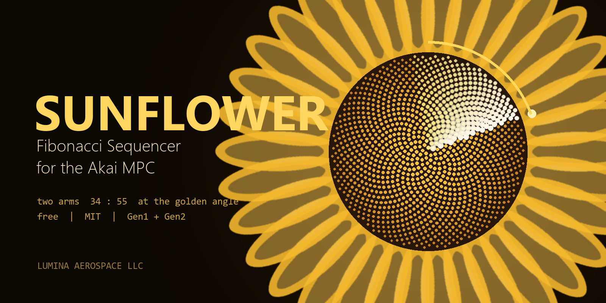
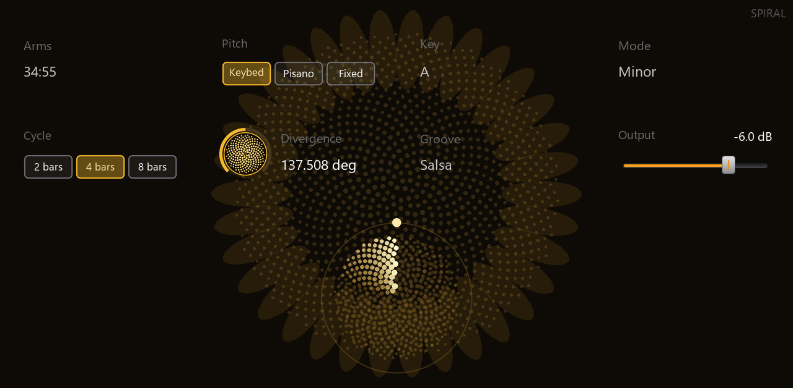

# Sunflower: Fibonacci Sequencer for the Akai MPC

**Lumina Aerospace LLC.** A free instrument plugin for the Akai MPC and Force (MPC OS 3.10.1 or later, external plugins enabled) that plays a sunflower.

A sunflower packs its seeds on two families of spirals, and the two counts are neighbouring Fibonacci numbers: 34 and 55 on a big flower. Sunflower plays that
lattice. Two **arms** step through the florets, one note per floret, and the pair you choose (3:5, 5:8, 8:13, 13:21, 21:34, 34:55) sets how fast each arm turns against
the other. The two cycles are coprime, so they meet only once per cycle: the melody and the bass keep drifting apart and locking up again, the way a Fibonacci spiral does.
Underneath, a small percussion bed (kick, clave or rim, conga, shaker) plays Salsa, Reggae, Cumbia or Bossa Nova.

It makes its own sound on purpose: the MPC ignores MIDI sent out by plugins, so a sequencer that wants to be heard has to carry its own voices.

## On the screen

- **SPIRAL**: Arms, Pitch (Keybed / Pisano / Fixed), Key, Mode (14 modes), Cycle (2, 4 or 8 bars), Divergence, Groove, Output.
- **MIX**: Arm Level, Perc Level, Pluck Decay.
- The **Divergence** knob is a picture of the lattice itself, from 130 to 145 degrees. At the golden angle, 137.508, the florets pack into the two spiral families; away from it
  they collapse into gaps and rays.
- The **sunflower at the bottom** is a **live playhead**: a bright comet sweeps the florets once per cycle of the arms, following the MPC's transport.

## Parameters

| Parameter | Range | Default |
|---|---|---|
| Output | -40 .. 6 dB | -6 |
| Arms | 3:5, 5:8, 8:13, 13:21, 21:34, 34:55 | 34:55 |
| Pitch | Keybed / Pisano / Fixed | Keybed |
| Key | C .. B | A |
| Mode | Minor, Major, Dorian, Phrygian, Lydian, Mixolydian, Locrian, Harmonic Minor, Melodic Minor, Pentatonic Major, Pentatonic Minor, Blues, Phrygian Dominant, Whole Tone | Minor |
| Cycle | 2 / 4 / 8 bars | 4 bars |
| Divergence | 130 .. 145 degrees | 137.508 |
| Groove | Salsa, Reggae, Cumbia, Bossa Nova, Off | Salsa |
| Arm Level | 0 .. 100 % | 80 |
| Perc Level | 0 .. 100 % | 70 |
| Pluck Decay | 0 .. 100 % | 50 |
| Playhead | display only, not automatable | |

Five programs: Sunflower 34:55, One Drop Spiral, Bossa Seeds, Cumbia Florets, Arms Only.

**Pitch.** *Keybed* picks one of 13 chromatic keybed nodes from each floret's angle; *Pisano* walks the Fibonacci numbers modulo the scale size (the Pisano period: 16 steps for a
7-note scale); *Fixed* plays the key's root. Whatever the mode, every arm note is snapped to the chosen mode, so the setting works in all three.

## Install

Unzip the release and copy the folder `Lumina Aerospace LLC - VST - Sunflower` into `VST2 Plugins` on the MPC's drive (`INSTALL.txt` in the zip has the steps). Both a 32-bit
(Force, MPC Live, One, X, Key) and a 64-bit (Live II, One+, Key 61, X SE, Live III) build are included.

## Status: please read

This is a first release. It builds clean for both MPC processors (32-bit ARM Cortex-A17 and 64-bit AArch64), passes the MPC Plugin SDK's host simulator (18 checks, no failures), and
its playhead was checked in a small real-time host (`tools/playhead_host.cpp`): about 8 updates a second, never a screen rebuild, within one frame (125 ms) of the transport.
**It has not yet been tried on a real MPC.** The playhead strip is 3.5 MB; if a device is short of memory, make the pictures smaller (`PH_SIZE` in `tools/make_skin.py`). Reports
of what works and what does not are very welcome.

The playhead updates about ten times a second, so it is a beat-level indicator, not a smooth sweep. It is a hidden, non-automatable parameter that the plugin moves itself and
reports to the host, which is the way other MPC plugins draw live meters.

## How it works

`src/lumina/` is a small header-only C++17 engine (Euclidean and Fibonacci pattern generation and a block-size-invariant scheduler). Each audio block, the host's song position goes
into the scheduler, which returns note events with sample offsets; they trigger the plugin's own voices (plucks for the two arms, a small synthesised percussion kit).
The engine allocates nothing, and neither does `process()`.

## Build

You need the [MPC Plugin SDK](https://github.com/inmusic-software/mpc-plugin-builder-sdk) toolchain checked out next to this folder (its `tools/build.py` and `framework/`), Python with Pillow and numpy,
and the SDK's bundled zig. Then:

    python tools/build.py "<this folder>"          # from the SDK root: native + arm32 + arm64 + validation
    python "<this folder>/tools/make_skin.py" "<this folder>"    # rebuild the touch skin (see its docstring)
    python tools/build.py "<this folder>"          # again, so the skin is copied
    python tools/package.py "<this folder>"        # the release zip

## Licence

MIT, Copyright (c) 2026 Lumina Aerospace LLC. See `LICENSE`. The MIT-licensed MPC Plugin SDK widgets used in the skin are recorded in `THIRD_PARTY_NOTICES.md`.
